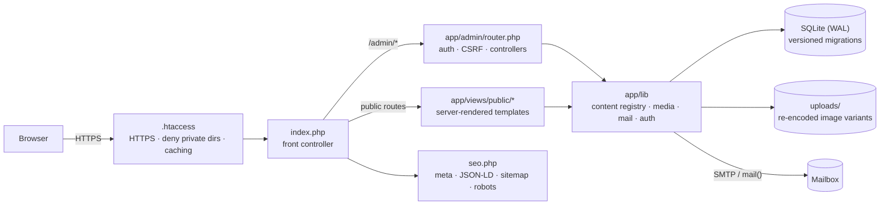

<div align="center">


# Nido Entrümpelung — Website & CMS

**A production website with its own content-management dashboard for a German clearance and house-clearing company.**
Plain PHP 8 and SQLite: no framework, no Composer, no build step, no third-party scripts.

[](#tech-stack)
[](#data-model)
[](#performance--quality)
[](#testing)
[](#tech-stack)

**Live:** [nido-entruempelung.de](https://nido-entruempelung.de)

</div>

---

## Highlights

| | |
|---|---|
| **Fast** | Lighthouse (mobile) **100 / 100 / 100 / 100**; LCP **333 ms** and CLS **0.00** in a trace of the live site. Self-hosted fonts, inline SVG icons, responsive WebP/JPEG variants, about 25 KB of CSS. |
| **Locked down** | Strict CSP with a per-request nonce (no inline scripts or styles), Argon2id hashing, CSRF on every write, brute-force lockout, re-encoded image uploads, PHP execution blocked in `uploads/`. |
| **Owner-editable** | Every heading, button, colour, font, logo, menu, service, gallery image and SEO field can be edited in `/admin`. No code changes needed. |
| **Local SEO** | JSON-LD `@graph` (LocalBusiness, Service, BreadcrumbList, WebSite), sitemap and robots generated from the database, per-page meta and Open Graph data, canonical URLs. |
| **Privacy-first** | No tracking cookies (only a technical session cookie for the contact form), no trackers, no Google Fonts. Google Maps loads only after a click (two-click solution), page-view counter stores no IPs. |
| **Documented for AI agents** | Three handbooks (`AI_SITE_GUIDE.md`, `SITE_MAP.md`, `AI_CHANGE_PROTOCOL.md`) let a future developer or AI agent change the site safely without having seen this conversation. |

---

## Features

### Public website (German)
- **Pages:** home, services overview, one detail page per service, filterable gallery with lightbox, contact page, Impressum, Datenschutz, custom 404.
- **Contact form:** server-side validation, honeypot field, time trap, per-IP rate limit and link limit. Each inquiry is stored in the database first, then e-mailed over SMTP or `mail()`. If mail delivery fails, the inquiry is still kept.
- **Conversion paths:** `tel:` and WhatsApp deep links, a sticky action bar on mobile, and pre-filled forms (`/kontakt?leistung=…`).
- **Accessibility:** WCAG AA contrast, visible keyboard focus, skip link, `prefers-reduced-motion`, semantic landmarks.

### Admin dashboard (`/admin`)
| Module | What the owner can do |
|---|---|
| Übersicht (overview) | Statistics, latest inquiries, system health checks, quick actions |
| Anfragen (inquiries) | Inbox with search, status workflow, read/unread state, mail-delivery status, one-click call / mail / WhatsApp |
| Startseite & Seitentexte (homepage & page texts) | All copy on every page, generated from a settings registry |
| Leistungen (services) | Create, edit and delete services; drag-and-drop ordering; icon, image, benefits and SEO per service |
| Galerie (gallery) | Categories, uploads, ordering, visibility |
| Kundenstimmen (testimonials) | Testimonials, shown only when entries exist |
| Logo & Design | Logos, favicon, brand colours, fonts, button style; changes go live without a build step |
| Kontakt & Firma (contact & company) | Company data, phone, WhatsApp, address, opening hours, social links |
| Navigation & Fußbereich (navigation & footer) | Header, footer and legal menus; footer content |
| SEO | Per-page title, description, canonical, Open Graph and noindex; site-wide defaults; Search Console verification |
| Medien (media) | Media library with alt texts, dimensions and usage tracking; a file cannot be deleted while it is in use |

---

## Architecture



- **Front controller and router.** One entry point, no framework. Routes live in plain `switch` statements and are easy to read.
- **Settings registry.** `registry()` in `content.php` defines each editable field once: type, label, default and help text. The same definition generates the admin form, validates input and supplies `setting('key')` to the templates. A new editable text takes one line.
- **Migrations.** Versioned with `PRAGMA user_version`, each runs once in a transaction, and they only ever add (never drop).
- **Media pipeline.** Uploads are checked with `finfo` and `getimagesize`, re-encoded with GD (which strips EXIF and anything embedded), saved under random names, and generated in 480, 960 and 1600 px variants for `srcset`.

## Tech stack
| Layer | Choice | Why |
|---|---|---|
| Backend | PHP 8.1+ (strict types), PDO | Runs on any shared host. No dependencies to patch. |
| Database | SQLite in WAL mode, foreign keys on | No database server. Backup = copy one file. |
| Frontend | Server-rendered HTML, vanilla CSS and JS | No hydration and no framework payload. |
| Fonts and icons | Self-hosted Barlow / Barlow Condensed (OFL), inline SVG | GDPR-friendly, no external requests |
| Mail | Small built-in SMTP client (SSL or STARTTLS) with a `mail()` fallback | No PHPMailer dependency |
| Tests | Python end-to-end suite (109 checks) | Tests the real HTTP surface the way a browser uses it |

## Data model
13 tables: `users`, `login_attempts`, `settings`, `media`, `services`, `gallery_categories`, `gallery_images`,
`inquiries`, `inquiry_attempts`, `nav_items`, `page_seo`, `testimonials`, `page_views`.
The full schema and every column are documented in [AI_SITE_GUIDE.md](AI_SITE_GUIDE.md).

## Security
- **Passwords:** Argon2id (bcrypt fallback). The initial password must be changed at first login. Minimum 10 characters, and common or weak passwords are rejected.
- **Sessions:** ID regenerated at login, `HttpOnly` + `SameSite=Lax` + `Secure` cookies, 2-hour idle timeout.
- **Brute force:** lockout after 5 failed logins per IP or 10 per username within 15 minutes.
- **CSRF** tokens on every POST and AJAX call. Every query uses prepared statements.
- **Headers:** CSP with a per-request nonce, HSTS, `X-Frame-Options`, `nosniff`, `Referrer-Policy`, `Permissions-Policy`.
- **Private files:** `app/`, `storage/`, `source/`, `docs/`, `.env`, `*.sqlite` and `*.md` are denied by `.htaccess`. The rules are recreated at runtime if one is missing.
- **Uploads:** no SVG accepted, every image re-encoded, and PHP, Python and CGI execution disabled in `uploads/`.

## Performance & quality
Measured on the live site (shared hosting, Lighthouse mobile emulation):

| Lighthouse | Score |
|---|---|
| Performance | 100 |
| Accessibility | 100 |
| Best Practices | 100 |
| SEO | 100 |

Performance trace: **LCP 333 ms**, **CLS 0.00**.

---

## Getting started

```bash
# 1. Configure (optional for local use)
cp .env.example .env

# 2. Run it with PHP's built-in server
php -S localhost:8080 index.php
```

Then open <http://localhost:8080>. The admin dashboard is at `/admin`: first login is `admin` / `ChangeMe-2026!`, and you are forced to change it.
The database and all tables are created on the first request.

**Requirements:** PHP ≥ 8.1 with `pdo_sqlite`, `gd` (JPEG/WebP), `mbstring` and `fileinfo`; Apache with `mod_rewrite` for production.
Docker instructions are in [AI_SITE_GUIDE.md](AI_SITE_GUIDE.md) (§28).

## Testing

```bash
python tests/e2e.py http://localhost:8080   # run against a fresh database
# → 109 passed, 0 failed
```

The suite covers every route, security headers and CSP, blocked private paths, the contact form (CSRF, honeypot, time trap, rate limit), the full admin login, lockout and forced-password-change flow, settings, services, gallery, uploads, the media library, SEO output and the sitemap.

## Project structure
```
index.php                 front controller + public routes + contact handler
app/
  bootstrap.php           env, security headers, session, CSRF, DB helpers, migrations
  lib/                    schema · content registry · seo · mail · auth · media · icons
  admin/                  router · UI helpers · controllers (core, content, inbox)
  views/public/           layout + page templates
assets/                   css · js · fonts (self-hosted) · img (logo, favicons, OG image)
docs/DEPLOYMENT.md        hosting, DNS and mail setup
tests/e2e.py              end-to-end test suite
AI_SITE_GUIDE.md          complete technical handbook (32 sections)
SITE_MAP.md               pages, sections, links, dashboard tree (Mermaid)
AI_CHANGE_PROTOCOL.md     rules for changing the site safely
```

## Documentation
| File | Contents |
|---|---|
| [AI_SITE_GUIDE.md](AI_SITE_GUIDE.md) | Architecture, brand, every setting, database schema, security, SEO, deployment, troubleshooting |
| [SITE_MAP.md](SITE_MAP.md) | Page hierarchy, sections per page, internal linking, dashboard navigation (Mermaid diagrams) |
| [AI_CHANGE_PROTOCOL.md](AI_CHANGE_PROTOCOL.md) | Step-by-step rules for content, design, schema and page changes, plus a test checklist |
| [docs/DEPLOYMENT.md](docs/DEPLOYMENT.md) | Hosting, domain, SSL and SMTP setup |

---

<sub>Client project, published as a portfolio piece. The brand name and logo belong to Nido Entrümpelung. Personal contact data in the default content has been replaced with placeholders (Max Mustermann, +49 151 00000000, Musterstraße 1). Secrets, the database and customer inquiries are not part of this repository.</sub>
