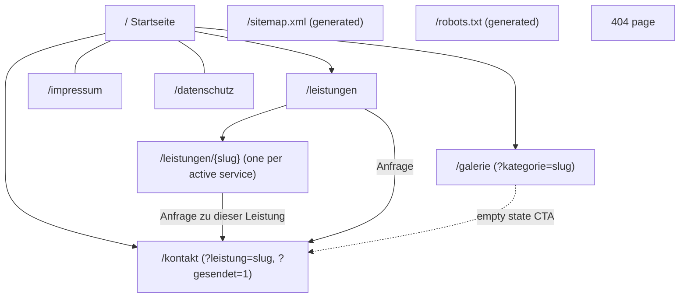
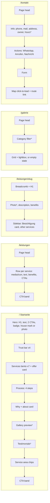
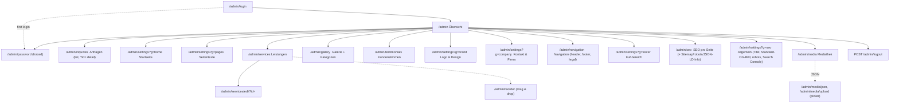

# SITE_MAP — Nido Entrümpelung

Companion of `AI_SITE_GUIDE.md`. Describes every page, section, link and dashboard screen **as implemented**.

## 1. Public page hierarchy

Default service pages (from the flyer): `entruempelung`, `haushaltsaufloesungen`, `keller-garagenraeumungen`, `sperrmuellentsorgung`, `entruempelung-gewerbeobjekte`, `besenreine-uebergabe`, `firmenaufloesungen`. Services can be added/removed in the dashboard; slugs follow the title.

## 2. Navigation structure (editable in dashboard → Navigation)

| Area | Default items |
|---|---|
| Header (`header`) | Start `/` · Leistungen `/leistungen` · Galerie `/galerie` · Kontakt `/kontakt` + phone button (from settings) |
| Footer pages (`footer`) | Start · Leistungen · Galerie · Kontakt |
| Footer legal (`legal`) | Impressum · Datenschutz |
| Mobile action bar (fixed, < 900 px) | Anrufen (`tel:`) · WhatsApp (`wa.me`) · Anfrage (`/kontakt#formular`) |

## 3. Sections per page

`*` = rendered only when data exists (images / testimonials / categories / hours / photo).

## 4. Internal linking
* Header/footer on every page; breadcrumbs on all subpages (also emitted as `BreadcrumbList` JSON-LD).
* Home service cards → `/leistungen/{slug}`; service pages → pre-filled contact form `/kontakt?leistung={slug}#formular`; area section → `/kontakt#karte`; trust/CTA buttons → `tel:`, `wa.me`, `/kontakt#formular`.
* Contact form → `/datenschutz`; map consent text → `/datenschutz#karte`.
* Sitemap lists all indexable pages; robots.txt points to the sitemap.

## 5. Admin dashboard navigation tree (`/admin`)

Dashboard module → what it controls:

| Module | Controls |
|---|---|
| Übersicht | stats (inquiries, services, gallery, views), recent inquiries, quick actions, status checks |
| Anfragen | inbox: search, status filter, read/unread, status (Neu / In Bearbeitung / Erledigt / Archiviert), delete, quick mail/phone/WhatsApp |
| Startseite / Seitentexte | all headings, paragraphs, buttons, labels |
| Leistungen / Galerie / Kundenstimmen | CRUD, order, visibility, images, categories |
| Logo & Design | logo(s), favicon, colours, fonts, button style |
| Kontakt & Firma | company, phone, WhatsApp, mail, address, hours, social |
| Navigation / Fußbereich | menus (add/edit/reorder/hide), footer texts/logo/copyright |
| SEO / Allgemein | per-page title, description, keywords, canonical, OG, noindex; site defaults; robots extras; Search Console code |
| Medien | uploads, previews, search, alt texts, size/dimensions, safe delete (blocked while in use) |
| Passwort | change admin password |
